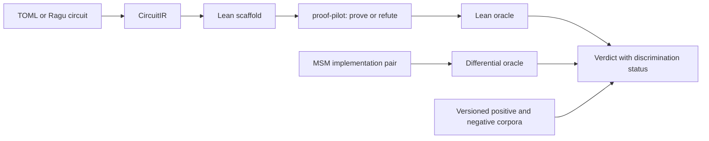

# Architecture

Scribe hosts acceptance oracles and measures their ability to distinguish known
positive and negative claims. The verdict core is independent of the subject:
a Lean proof and a differential test are different kinds of evidence.

## Data flow

## Crate boundaries

| Crate | Responsibility |
|---|---|
| `scribe-core` | Domain-independent claims, oracles, corpora, outcomes and verdicts; every verdict carries measured or explicitly unmeasured discrimination. |
| `circuit-ir` | Polynomial constraints, public/private variables, specifications and provenance; TOML/JSON representation. |
| `scribe-frontend` | Circuit extraction interface. |
| `frontend-toml` | Hand-authored TOML input and emitter regression snapshots. |
| `frontend-ragu` | Structure-only Ragu extraction, checked against host gate/constraint counts; pinned upstream revision. |
| `scribe-macros` | Extraction through a circuit crate's ordinary Rust tests. |
| `lean-emit` | Circuit proof/refutation scaffolds and audit commands. |
| `proof-pilot` | Bounded LLM proof-body editing, build/LSP feedback, journals and replay. |
| `oracle-lean` | Circuit claims adjudicated by kernel-checked proofs or refutations; exhaustion remains undetermined. |
| `oracle-differential` | Finite MSM differential comparisons and their discrimination corpus; not a universal equivalence proof. |
| `scribe-cli` | User commands, schema checks, artifact binding, cache and corpus operations. |
| `bench` | Repeated gadget sessions, pass@k, Wilson intervals and planted-negative alarms. |

## Acceptance boundaries

The proof loop builds the Lake project and compiles the exact target file.
It patches proof bodies while preserving statements, and screens forbidden
source tokens. Generated circuit scaffolds carry `#audit_axioms`, which checks
transitive dependencies against `{propext, Classical.choice, Quot.sound}`.
A scaffold containing a proof hole must fail that gate. A successful build alone
is not an axiom audit for arbitrary external Lean files.

`scribe check` binds recorded artifacts to regenerated circuit statements before
caching their evidence. C1 hypothesis-use probes are reported, non-gating in
that path; syntactic use is not proof that an assumption is logically necessary.
C2/C3 finite-model witnesses test conclusion falsifiability and antecedent
satisfiability. These checks provide evidence about a specification, not a proof
that it expresses the intended protocol.

A refutation is evidence against the precise statement instantiated. Exhausting
a refutation budget is not a soundness proof. Likewise, benchmark refusal of a
planted negative is distinct from constructing its counterexample.

## Scope

Current extraction and benchmarks primarily target circuit constraints; they do
not establish protocol soundness or Rust-to-Lean semantic refinement. Retired
integrations are recoverable from the archive revision listed in the README.
